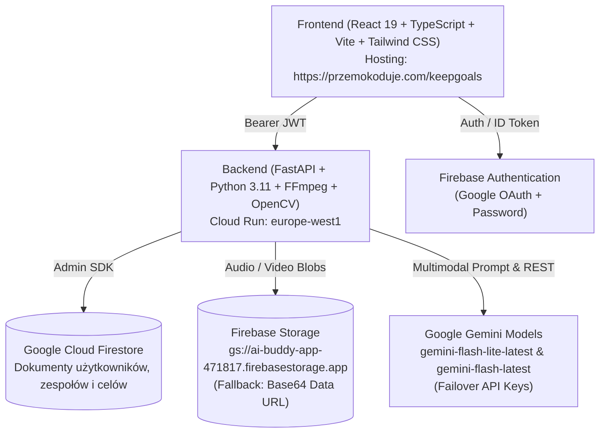
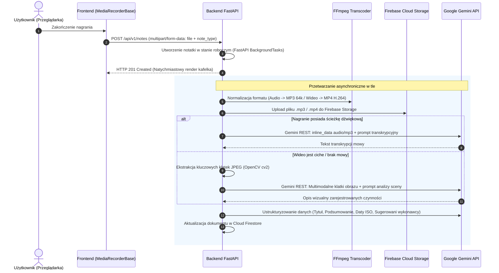

# keepGoals — Kompletna Specyfikacja Architektoniczna i Funkcjonalna Systemu

> **Dokumentacja analityczna dla modeli językowych (LLM) oraz inżynierów oprogramowania.**  
> Prezentuje pełną architekturę techniczną, przepływy danych, reguły biznesowe, struktury bazodanowe, kontrakty API oraz zintegrowane mechanizmy AI aplikacji **keepGoals**.

---

## 1. Wprowadzenie i Cel Systemu

**keepGoals** to hybrydowy system zarządzania produktywnością, notatkami multimodalnymi, celami strategicznymi (OKR) oraz operacyjnymi inspekcjami technicznymi. Łączy intuicyjną lekkość interfejsu wzorowanego na **Google Keep** z zaawansowaną analizą poznawczą opartą wyłącznie na modelach z rodziny **Google Gemini**.

### Główne filary systemu:
1. **Multimodalne Notatki Operacyjne:** tekst (GFM z interaktywnymi checklistami), rysunki odręczne (Canvas/PNG), nagrania audio (dyktafon), nagrania wideo (kamera) oraz inspekcje w czasie rzeczywistym.
2. **Kognitywny Potok Gemini AI:** transkrypcja mowy (Gemini REST multimodal), automatyczna ekstrakcja tytułów, podsumowań, zadań, wykrywanie terminów w kalendarzu (ISO-8601 z 1-klikiem do Google Calendar) i sugerowanie przypisań do członków zespołów.
3. **Konwersacyjny Asystent Notatek:** czat kontekstowy z notatką zasilany pełną treścią, transkrypcją oraz klatkami wideo (`cv2`), potrafiący przepisać notatkę w całości za pomocą tagów `<REWRITTEN_NOTE>`.
4. **Inspektor Budowlano-Techniczny (Gemini Live Inspector):** asystent inspekcji wideo/audio w czasie rzeczywistym z syntezą mowy (Web Speech API) działający w trybie sekretarza i biegłego inżyniera budowlanego.
5. **System Delegowania Zadań (Handoff & Magic Links):** podział notatki na zadania per wykonawca, generowanie tokenów publicznych bez konieczności logowania, powiadomienia e-mail (SMTP) i automatyczny cykl życia statusów: `sent` -> `viewed` -> `done`.
6. **Strategiczne Cele OKR & Oś Priorytetów 2D:** dwuwymiarowy wykres pozycjonowania zadań (Wpływ vs. Dźwignia celu) z doradcą strategicznym AI generującym interaktywne kafelki przez tagi `<SUGGESTED_TILE>`.
7. **Pętla Dnia: Plan Poranny i Refleksja Wieczorna:** generowanie planu dnia w oparciu o cele strategiczne oraz wieczorny mentoring psychologiczno-nawrotowy.

---

## 2. Architektura Techniczna i Stos Technologiczny



### Stos Technologiczny:
- **Frontend:** React 19, TypeScript, Vite, Tailwind CSS, `@dnd-kit` (drag-and-drop sortowanie notatek), `lucide-react`, `react-markdown` + `remark-gfm`.
- **Backend:** FastAPI, Python 3.11, Uvicorn, Pydantic v2, `ffmpeg-python`, `opencv-python-headless`.
- **Infrastruktura & Chmura:** Google Cloud Run, Firebase Authentication, Cloud Firestore, Firebase Cloud Storage.
- **Silnik AI:** Modele Google Gemini (`gemini-flash-lite-latest`, `gemini-flash-latest`). Dostęp hybrydowy:
  - *Native REST Gemini API* (`v1beta/models/...:generateContent`) dla przesyłania binarnego audio/wideo (`inline_data`).
  - *OpenAI-Compatible Gemini Endpoint* (`v1beta/openai/chat/completions`) dla czatu i ustrukturyzowanych odpowiedzi JSON.
  - *Automatyczny failover kluczy:* `GEMINI_API_KEY` z automatyczną rezerwą na `GEMINI_FALLBACK_API_KEY`.

---

## 3. Model Danych i Struktury Firestore

Dane izolowane są per użytkownik (`uid`), z wyjątkiem publicznych delegacji (`share_token`) oraz globalnych zespołów.

### Hierarchia kolekcji Firestore:
- `users/{uid}/notes/{note_id}` — notatki użytkownika
- `users/{uid}/projects/{project_id}` — projekty
- `users/{uid}/goals/{goal_id}` — cele strategiczne OKR
- `users/{uid}/goals/{goal_id}/diagram/axis_tiles` — kafelki wykresu osi 2D
- `users/{uid}/settings/preferences` — ustawienia strefy czasowej, kosza
- `teams/{team_id}` — zespoły i członkowie
- `notes/{note_id}/delegations/{delegation_id}` — historia delegowania (indeksowane po `share_token`)

### Kluczowe Schematy Danych (Pydantic / TypeScript):

```python
# Model notatki (FastAPI / Firestore)
class DetectedEvent(BaseModel):
    title: str
    date: str              # Format ISO-8601 YYYY-MM-DD
    time: Optional[str]    # HH:MM
    description: Optional[str]

class NoteResponse(BaseModel):
    id: str
    title: Optional[str]
    content: Optional[str]
    note_type: str         # 'text' | 'checklist' | 'drawing' | 'audio' | 'video' | 'daily_morning' | 'daily_evening'
    media_url: Optional[str]     # Publiczny URL do Firebase Storage lub Data URL (data:audio/mp3;base64,...)
    audio_url: Optional[str]     # Zgodność wsteczna
    raw_transcript: Optional[str]# Dosłowny zapis mowy z modelu Gemini
    summary: Optional[str]       # Streszczenie wykonawcze
    events: List[DetectedEvent] = [] # Wykryte terminy kalendarzowe
    suggested_assignees: List[str] = []
    color: str = "#ffffff"
    is_pinned: bool = False
    is_archived: bool = False
    is_deleted: bool = False     # Soft-delete (Kosz)
    deleted_at: Optional[datetime]
    project_ids: List[str] = []
    order: int = 0
    created_at: datetime
    updated_at: datetime

# Cel strategiczny OKR
class KeyResult(BaseModel):
    id: str
    description: str
    target_value: float
    current_value: float = 0.0
    unit: str

class GoalResponse(BaseModel):
    id: str
    title: str
    description: Optional[str]
    horizon: str           # 'long_term' | 'quarterly' | 'monthly'
    is_completed: bool = False
    key_results: List[KeyResult] = []
    color: str = "#ffffff"
    created_at: datetime
    updated_at: datetime

# Kafelek na osi 2D
class AxisTileItem(BaseModel):
    id: str
    title: str
    category: str          # 'goal' | 'operational' | 'distraction'
    x: float               # Pozycja X (0 - 100%): <40% dystrakcje, 40-60% operacyjne, >60% cel
    y: float               # Pozycja Y (14 - 84%): waga/wpływ zadania (determinuje rozmiar)
    notes: Optional[str]
```

---

## 4. Szczegółowa Specyfikacja Modułów Funkcjonalnych

### 4.1. Notatki Multimodalne i Interfejs Użytkownika
1. **Tryb Checklisty (`checklist`):**
   - Notatka zapisuje elementy w składni Markdown GFM (`- [ ] zadanie`, `- [x] wykonane`).
   - `MarkdownRenderer.tsx` parsuje treść i separuje listę na sekcję aktywną oraz sekcję pozycji ukończonych (ze skreśleniem tekstu). Kliknięcie checkboxa wysyła zapytanie `PATCH /api/v1/notes/{id}` natychmiastowo aktualizując stan w Firestore.
2. **Tryb Rysowania (`drawing`):**
   - Komponent Canvas HTML5 z wyborem grubości linii i palety barw.
   - Po zakończeniu szkic jest eksportowany do `image/png` jako Data URL i zapisywany w `media_url`.
3. **Karty na pulpicie (`NoteCard.tsx`):**
   - Na kafelkach siatki głównej **nie ma ciężkich odtwarzaczy HTML5** audio/wideo.
   - Kafelki prezentują jedynie czytelne ikony stanu (`<Headphones />` dla audio, `<Play />` dla wideo), treść w Markdown, wykryte daty z przyciskiem eksportu do Google Calendar oraz stos awatarów osób, którym oddelegowano zadanie.
4. **Modal Szczegółów (`NoteModal.tsx`):**
   - Posiada pełny odtwarzacz `<audio controls>` lub `<video controls>` z obsługą streamingu.
   - **Ochrona przed przypadkową edycją:** Kliknięcie w pole tekstowe nie włącza trybu edycji. Aby zmodyfikować tytuł lub treść, użytkownik musi świadomie aktywować przycisk *„Opcje formatowania”* (`<Baseline />`) na pasku narzędzi.
   - Udostępnia zakładkę **„Transkrypcja”** z możliwością skopiowania dosłownego tekstu AI lub wysłania go jednym kliknięciem mailem.

---

### 4.2. Kognitywny Potok Przetwarzania Audio i Wideo

Każde nagranie głosu lub wideo z kamery przechodzi automatyczny, asynchroniczny potok w tle:



#### Esencjonalny kod potoku transkrypcji i ekstrakcji klatek (`ai_service.py`):
```python
def transcribe_audio_with_gemini(audio_bytes: bytes, mime_type: str = "audio/mp3") -> str:
    """Transkrypcja mowy na tekst za pomocą natywnego API Google Gemini."""
    url = f"https://generativelanguage.googleapis.com/v1beta/models/gemini-flash-latest:generateContent?key={GEMINI_API_KEY}"
    payload = {
        "contents": [{
            "parts": [
                {"text": "Dokonaj dokładnej, dosłownej transkrypcji tego nagrania w języku polskim."},
                {"inline_data": {"mime_type": mime_type, "data": base64.b64encode(audio_bytes).decode("utf-8")}}
            ]
        }]
    }
    resp = requests.post(url, json=payload, timeout=60)
    return resp.json()["candidates"][0]["content"]["parts"][0]["text"].strip()

def extract_video_frames(video_bytes: bytes, max_frames: int = 6) -> list[bytes]:
    """Wyodrębnia do 6 reprezentatywnych klatek JPEG z materiału wideo przez OpenCV."""
    with tempfile.NamedTemporaryFile(suffix=".mp4", delete=False) as f:
        f.write(video_bytes)
        tmp = f.name
    cap = cv2.VideoCapture(tmp)
    total = int(cap.get(cv2.CAP_PROP_FRAME_COUNT))
    step = max(1, total // max_frames)
    frames = []
    for i in range(0, total, step):
        cap.set(cv2.CAP_PROP_POS_FRAMES, i)
        ret, frame = cap.read()
        if ret:
            _, buf = cv2.imencode(".jpg", frame, [cv2.IMWRITE_JPEG_QUALITY, 70])
            frames.append(buf.tobytes())
        if len(frames) >= max_frames: break
    cap.release()
    os.remove(tmp)
    return frames
```

---

### 4.3. Kontekstowy Czat AI z Notatką i Tag `<REWRITTEN_NOTE>`

Każda notatka posiada dedykowany modal konwersacyjny (`NoteAIChatModal.tsx` -> `POST /api/v1/notes/{note_id}/ai-chat`).
- AI otrzymuje pełny kontekst: aktualną treść, transkrypcję audio, wykryte terminy oraz wyekstrahowane klatki wideo.
- Jeśli użytkownik w rozmowie poprosi o sformatowanie, poprawę stylu, uzupełnienie punktów czy całkowitą zmianę notatki, model zwraca odpowiedź konwersacyjną oraz wbudowany tag XML:
  ```markdown
  Oto zaktualizowana i uporządkowana wersja Twojej notatki:
  
  <REWRITTEN_NOTE>
  # Tytuł Notatki
  - [ ] Kluczowe zadanie 1
  - [ ] Kluczowe zadanie 2
  
  Szczegóły ustaleń ze spotkania...
  </REWRITTEN_NOTE>
  ```
- Frontend wykrywa znacznik `<REWRITTEN_NOTE>`, wyświetla użytkownikowi przycisk **„Zastosuj zmiany w notatce”**, którego kliknięcie natychmiast nadpisuje treść notatki w bazie danych.

---

### 4.4. Gemini Live Technical Property Inspector

Moduł inspekcyjno-budowlany (`GeminiLiveInspector.tsx` -> `POST /api/v1/notes/live-inspect`).
- Działa bezpośrednio na budowie lub podczas odbioru nieruchomości.
- Wykorzystuje kamerę urządzenia, Web Speech API (`SpeechRecognition` do ciągłego nasłuchu mowy oraz `speechSynthesis` do odpowiedzi głosowych) oraz Web Audio API do generowania sygnałów akustycznych (dźwięk chimes).
- **Dwa tryby pracy:**
  1. **Tryb Sekretarza (Voice Log):** Użytkownik dyktuje uwagi w trakcie chodzenia po obiekcie. Asystent milczy lub odpowiada lakonicznym *"Zanotowałem."*, rejestrując uwagi na osi czasu.
  2. **Tryb Biegłego Eksperta ("Ekspertyza AI"):** Użytkownik kieruje obiektyw na problem (np. pęknięcie tynku, mostek termiczny, błąd montażu stolarki) i zadaje pytanie. System pobiera klatkę JPEG w rozdzielczości 1280x720 i wysyła ją wraz z zapytaniem do Gemini. Model analizuje problem posługując się normami budowlanymi (PN-EN), ocenia ryzyko i generuje ustrukturyzowany protokół usterki wraz ze zdjęciem miniatury.
- Po zakończeniu inspekcji generowany jest kompleksowy **Raport Techniczny w formacie Markdown**, zapisywany jako standardowa notatka w keepGoals.

---

### 4.5. Delegowanie Zadań (Handoff) i Publiczne Magic Links

Umożliwia przekazanie części lub całości notatki dowolnej osobie bez wymogu posiadania konta w aplikacji:
1. **Ekstrakcja Zadań przez AI:** Model Gemini analizuje treść i przygotowuje zwięzłe podsumowanie dedykowane dla wybranego wykonawcy.
2. **Generowanie Magic Link:** Tworzony jest unikalny, bezpieczny `share_token` (UUIDv4) dostępny pod adresem:
   `https://przemokoduje.com/keepgoals/shared/{share_token}`.
3. **Powiadomienie E-mail:** Jeśli podano adres e-mail odbiorcy, backend wysyła estetyczną wiadomość HTML przez SMTP.
4. **Cykl Życia Statusu Delegacji:**
   - `sent` — zadanie wysłane.
   - `viewed` — odbiorca otworzył stronę z linkiem (zmiana statusu rejestrowana automatycznie przez `GET /api/v1/public/notes/{token}`).
   - `done` — wykonawca kliknął przycisk *"Oznacz jako wykonane"* na publicznym widoku (`POST /api/v1/public/notes/{token}/complete`).
5. Na kafelkach notatek właściciel widzi dynamiczny badge: żółty (wysłane), niebieski (wyświetlone), zielony (ukończone).

---

### 4.6. Strategiczne Cele OKR i Interaktywny Diagram Osi 2D

Moduł celów (`/goals`) realizuje metodologię OKR z podziałem na horyzonty: **Długoterminowe**, **Kwartalne** i **Miesięczne** oraz mierzalne wskaźniki `key_results` (np. `0 / 10 000 PLN`).

#### Interaktywny Wykres Osi 2D (`GoalDiagram.tsx`):
Wizualizuje rozkład aktywności i zadań w przestrzeni dwóch wymiarów:
- **Oś Pozioma X (0% - 100%): Strategiczna Dźwignia**
  - `< 40%`: *Brak realizacji / Rozpraszacze* (czerwona strefa)
  - `40% - 60%`: *Działania Operacyjne / Utrzymanie* (żółta strefa)
  - `> 60%`: *Wysoka Dźwignia / Cel Strategiczny* (zielona strefa)
- **Oś Pionowa Y (14% - 84%): Waga i Wpływ Zadania**
  - Wartość Y bezpośrednio kontroluje fizyczny rozmiar kafelka na wykresie.
- **Doradca AI Osi 2D (`suggest_tiles_for_goal`):**
  Model Gemini potrafi przeanalizować cele użytkownika i zaproponować optymalne kafelki za pomocą składni:
  ```xml
  <SUGGESTED_TILE title="Automatyzacja testów E2E" x="75" y="60">
  Kluczowe działanie skracające czas wdrożenia o 40%.
  </SUGGESTED_TILE>
  ```
  Kliknięcie sugestii natychmiast umieszcza kafelek na diagramie.

---

### 4.7. Plan Poranny i Refleksja Wieczorna

Automatyczna pętla budowania nawyków:
- **Plan Poranny (`POST /api/v1/plans/morning`):**
  Backend pobiera aktywne cele strategiczne (`note_type == 'strategic'`). Gemini generuje listę 3-5 kluczowych priorytetów dnia w formacie checklisty Markdown, tworząc nową notatkę `daily_morning`.
- **Wieczorna Refleksja Mentorska (`POST /api/v1/plans/evening`):**
  Użytkownik wprowadza wykonane zadania, zadania pominięte oraz pokusy/złe nawyki, którym udało się oprzeć (*positive omissions*). Gemini w roli empatycznego, ale stanowczego mentora produktywności analizuje dzień, wskazuje błędy poznawcze i tworzy notatkę podsumowującą `daily_evening`.

---

## 5. Zestawienie Endpointów REST API

| Metoda | Ścieżka API | Uprawnienia | Opis funkcjonalny |
|---|---|---|---|
| `GET` | `/api/v1/notes` | Bearer Token | Pobiera listę notatek użytkownika (filtry: `project_id`, `tag`, `is_archived`) |
| `POST` | `/api/v1/notes` | Bearer Token | Tworzy notatkę (tekstową lub plik audio/wideo multipart/form-data) |
| `PATCH` | `/api/v1/notes/{id}` | Bearer Token | Częściowa aktualizacja (treść, tytuł, kolor, przypięcie) |
| `DELETE` | `/api/v1/notes/{id}` | Bearer Token | Przeniesienie do Kosza (`is_deleted=True`) lub trwałe usunięcie |
| `POST` | `/api/v1/notes/reorder` | Bearer Token | Zapis nowej kolejności kart po przeciągnięciu Drag & Drop |
| `POST` | `/api/v1/notes/{id}/reanalyze` | Bearer Token | Wymuszenie ponownej transkrypcji i analizy AI z istniejącego pliku |
| `POST` | `/api/v1/notes/{id}/ai-chat` | Bearer Token | Czat kontekstowy z notatką (wspiera `<REWRITTEN_NOTE>`) |
| `POST` | `/api/v1/notes/{id}/handoff` | Bearer Token | Oddelegowanie zadania, generowanie `share_token`, wysyłka maila |
| `POST` | `/api/v1/notes/live-inspect` | Bearer Token | Analiza klatki wideo i mowy w module Inspektora Budowlanego |
| `GET` | `/api/v1/public/notes/{token}` | Publiczny | Podgląd oddelegowanego zadania przez wykonawcę (oznacza `viewed`) |
| `POST` | `/api/v1/public/notes/{token}/complete` | Publiczny | Oznaczenie oddelegowanego zadania jako wykonane (`done`) |
| `GET` | `/api/v1/goals` | Bearer Token | Pobranie listy celów OKR (filtry: `horizon`, `is_completed`) |
| `POST` | `/api/v1/goals` | Bearer Token | Utworzenie nowego celu strategicznego |
| `GET` | `/api/v1/goals/{id}/axis-tiles` | Bearer Token | Pobranie kafelków wykresu osi 2D |
| `PUT` | `/api/v1/goals/{id}/axis-tiles` | Bearer Token | Zapis pozycji kafelków na diagramie 2D |
| `POST` | `/api/v1/goals/{id}/suggest-tiles` | Bearer Token | Sugestie nowych kafelków osi 2D przez Gemini |
| `POST` | `/api/v1/plans/morning` | Bearer Token | Generowanie porannego planu dnia z celów strategicznych |
| `POST` | `/api/v1/plans/evening` | Bearer Token | Wieczorna refleksja i analiza dnia przez mentora AI |
| `GET` | `/api/v1/projects` | Bearer Token | Pobranie listy projektów użytkownika wraz z licznikami notatek |
| `GET` | `/api/v1/users/settings` | Bearer Token | Pobranie preferencji (strefa czasowa, retencja kosza w dniach) |

---

## 6. Kluczowe Wzorce Implementacyjne i Prompty AI

### 6.1. Odporny Potok Zapisu Mediów (`storage_service.py`)
System gwarantuje, że żadne nagranie nie zostanie utracone, nawet w przypadku awarii Cloud Storage lub braku uprawnień:
```python
def save_media_file(file_bytes: bytes, filename: str, mime_type: str, uid: str) -> str:
    """
    Zapisuje plik binarny w Google Cloud Storage.
    W przypadku błędu uprawnień/konta automatycznie stosuje Fallback
    do wbudowanego Base64 Data URL (RFC 2397).
    """
    try:
        bucket = storage.bucket()
        blob_path = f"users/{uid}/media/{filename}"
        blob = bucket.blob(blob_path)
        blob.upload_from_string(file_bytes, content_type=mime_type)
        blob.make_public()
        return blob.public_url
    except Exception as e:
        logger.warning(f"GCS upload failed ({e}), using inline Base64 data-URL fallback")
        b64_content = base64.b64encode(file_bytes).decode("utf-8")
        return f"data:{mime_type};base64,{b64_content}"
```

### 6.2. System Prompt Inspektora Technicznego (`ai_service.py`)
```python
LIVE_INSPECTOR_SYSTEM_PROMPT = """
Jesteś doświadczonym, dyplomowanym inżynierem budowlanym i biegłym rzeczoznawcą budowlanym.
Użytkownik prowadzi inspekcję na żywo przez kamerę telefonu.

Jeśli użytkownik zada pytanie techniczne lub poprosi o ekspertyzę:
1. Dokonaj rygorystycznej oceny wizualnej przedstawionej wady lub elementu.
2. Odwołaj się do zasad sztuki budowlanej i norm technicznych (PN-EN).
3. Podaj bezpośrednią przyczynę usterki, stopień ryzyka (niski/średni/krytyczny) oraz zalecany sposób naprawy.
Odpowiedź musi być zwięzła, profesjonalna i gotowa do umieszczenia w protokole odbioru.
"""
```

### 6.3. Ochrona Przed Przypadkową Edycją Notatki (`NoteModal.tsx`)
```tsx
// Aktywacja trybu edycji WYŁĄCZNIE po kliknięciu ikony Opcje Formatowania (<Baseline />)
const [isEditing, setIsEditing] = useState(false);

return (
  <div className="flex flex-col h-full">
    {/* Pasek narzędziowy modalu */}
    <div className="flex items-center gap-1 border-b border-gray-100 p-2">
      <button
        onClick={() => setIsEditing(!isEditing)}
        title="Opcje formatowania (włącz/wyłącz edycję)"
        className={`p-2 rounded-lg transition-colors ${
          isEditing ? "bg-amber-100 text-amber-800" : "hover:bg-gray-100 text-gray-600"
        }`}
      >
        <Baseline className="w-5 h-5" />
      </button>
    </div>

    {/* Treść notatki: Podgląd Markdown lub Edytor */}
    <div className="p-4 flex-1 overflow-y-auto">
      {isEditing ? (
        <textarea
          value={content}
          onChange={(e) => setContent(e.target.value)}
          className="w-full h-full p-2 border rounded-lg focus:ring-2 focus:ring-amber-500"
        />
      ) : (
        <div className="prose max-w-none">
          <MarkdownRenderer content={content} onChecklistToggle={handleToggleChecklist} />
        </div>
      )}
    </div>
  </div>
);
```

---

## 7. Podsumowanie dla Modeli Językowych (Analiza & Rozbudowa)

Przy analizowaniu lub rozbudowie systemu keepGoals należy pamiętać o następujących założeniach architektonicznych:
1. **Jednolity ekosystem AI:** Wszystkie zadania językowe i multimodalne (mowa, wizja, czat, doradztwo) są obsługiwane wyłącznie przez modele **Google Gemini**.
2. **Asynchroniczność zadań ciężkich:** Transkrypcje, konwersje `ffmpeg` oraz generowanie podsumowań nigdy nie blokują odpowiedzi HTTP endpointów tworzenia notatki — użytkownik natychmiast otrzymuje potwierdzenie zoptymalizowane pod kątem UX.
3. **Izolacja danych i bezpieczeństwo:** Każdy zasób w Firestore jest autoryzowany przez token Firebase Auth. Publiczny dostęp dotyczy wyłącznie zapytań z ważnym, losowym tokenem delegacji (`share_token`).
4. **Czystość interfejsu (UX/UI):** Karty główne są lekkie i bezstanowe multimedialnie; cała złożona interakcja (odtwarzanie, edycja formatowania, czat AI) odbywa się w dedykowanych modalach.

